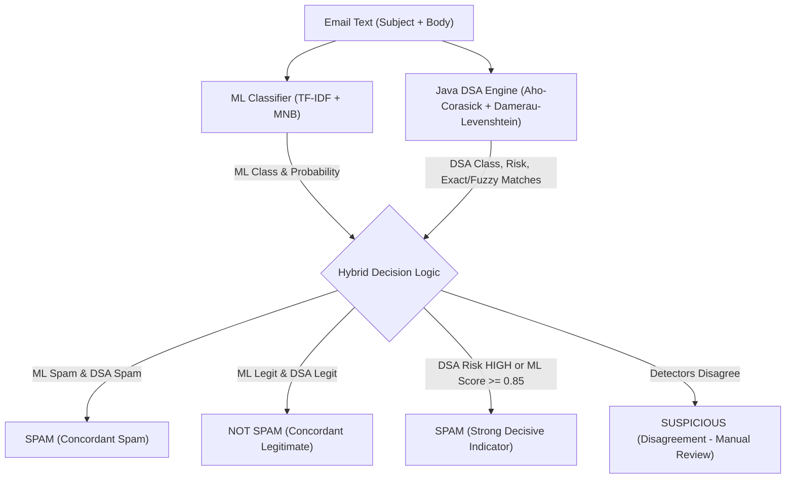

# Intelligent Email Detection and Management Platform

An integrated, enterprise-ready, academically rigorous full-stack email management and dual-engine spam detection platform. The system unifies a relational PostgreSQL database schema with automated PL/pgSQL triggers, an asynchronous FastAPI backend (Python 3.13), a TF-IDF + Multinomial Naive Bayes Machine Learning classifier, a standalone high-performance Java DSA Spam Detection Engine (Aho–Corasick Multi-Pattern Trie + Damerau–Levenshtein Dynamic Programming), and a responsive React single-page dashboard.

---

## 1. System Architecture

```mermaid
graph TD
    UserClient["React 19 Frontend (:5173)"] -->|HTTP / JWT Bearer| FastAPI["FastAPI REST Backend (:8000)"]
    FastAPI -->|psycopg2 / SQLAlchemy| Postgres[("PostgreSQL 18 DB (:5432)")]
    FastAPI -->|In-Process NLP Pipeline| MLEngine["ML Classifier (TF-IDF + Naive Bayes)"]
    FastAPI -->|HTTP REST (:8080)| JavaDSA["Java DSA Engine (:8080)"]
    
    subgraph Java DSA Algorithms
        JavaDSA --> AC["Aho-Corasick Multi-Pattern Trie"]
        JavaDSA --> DL["Damerau-Levenshtein Fuzzy DP"]
        JavaDSA --> HM["HashMap Frequency Analysis"]
        JavaDSA --> PQ["PriorityQueue Max-Heap Ranking"]
    end

    subgraph Relational Persistence
        Postgres --> T1["spam_detection (ML Results)"]
        Postgres --> T2["dsa_detection (DSA Results)"]
        Postgres --> Trg["Triggers -> email_audit_log"]
    end
```

### Architectural Principles
- **Strict Decoupling:** The React frontend communicates **ONLY** with FastAPI (:8000). The Java DSA Engine (:8080) is an internal backend microservice bound to `127.0.0.1` and is never exposed directly to the browser.
- **Dual-Engine Detection:** Every email evaluated receives both an NLP Machine Learning prediction and a Java Data Structures & Algorithms pattern analysis.
- **Relational Integrity (3NF):** Machine Learning results are stored in `spam_detection`, while Java DSA pattern results are stored in `dsa_detection`. Automated PL/pgSQL triggers synchronize email status and maintain immutable audit histories in `email_audit_log`.
- **Zero-Bypass Security:** All spam detection, search, and email retrieval endpoints enforce JWT authentication, mailbox isolation, and BOLA/IDOR protections.

---

## 2. Technology Stack & Ports

| Layer | Technologies | Network Binding |
|---|---|---|
| **Frontend** | React 19, Vite, Tailwind CSS, Lucide React | `http://127.0.0.1:5173` |
| **Backend API** | FastAPI, Starlette, Pydantic v2, SQLAlchemy 2.0 | `http://127.0.0.1:8000` |
| **Java DSA Engine** | Core Java (JDK 25/21/17), com.sun.net.httpserver | `http://127.0.0.1:8080` |
| **Database** | PostgreSQL 18, PL/pgSQL triggers, GIN full-text index | `localhost:5432` (`email_management_db`) |
| **Machine Learning** | Scikit-Learn (MultinomialNB), TF-IDF Vectorizer, Joblib | In-process Python |

---

## 3. DSA Engine & Academic Complexity Analysis

The Java DSA Engine (`dsa-engine/`) provides concrete, academically demonstrable implementations of classic computer science algorithms:

### 1. Aho–Corasick String Matching (`core.AhoCorasick`)
- **Concept:** Constructs a finite-state machine combining a Trie with failure links (derived from Breadth-First Search).
- **Application:** Simultaneously searches for multiple spam patterns (`free`, `winner`, `win money`, `prize`, `lottery`, `urgent`, `click here`, `claim reward`) in an email text in a single linear pass.
- **Time Complexity:** 
  - Construction: $\mathcal{O}(P)$ where $P$ is the sum of pattern lengths.
  - Search: $\mathcal{O}(N + Z)$ where $N$ is text length and $Z$ is the count of matches.
- **Space Complexity:** $\mathcal{O}(P \times \Sigma)$ where $\Sigma$ is alphabet size.

### 2. Damerau–Levenshtein Distance (`core.DamerauLevenshtein`)
- **Concept:** Dynamic programming algorithm calculating edit distance with 4 atomic operations: insertion, deletion, substitution, and adjacent character transposition.
- **Application:** Catches obfuscated spam typos and adversarial variations (e.g. `fr33 -> free`, `pr1ze -> prize`, `w1nner -> winner`, `cl1ck -> click`).
- **Time Complexity:** $\mathcal{O}(M \times N)$ where $M$ and $N$ are string lengths.
- **Space Complexity:** $\mathcal{O}(M \times N)$ 2D DP matrix.

### 3. HashMap Frequency Tracking (`main.EmailAnalyzer`)
- **Concept:** Hash table mapping identified suspicious patterns to occurrence counts.
- **Time Complexity:** Average $\mathcal{O}(1)$ lookup and insertion.

### 4. PriorityQueue Max-Heap (`main.SpamDetector`)
- **Concept:** Binary heap ordering emails by calculated spam risk score.
- **Time Complexity:** $\mathcal{O}(\log K)$ insertion and extraction.

---

## 4. Machine Learning Spam Classifier

The ML detector (`ml/`) utilizes an optimized NLP pipeline:
- **Feature Extraction:** Sublinear TF-IDF vectorization with unigrams and bigrams (2,500 dimensions).
- **Classifier:** Multinomial Naive Bayes with Laplace smoothing ($\alpha = 0.5$).
- **Holdout Test Accuracy:** **94.44%** | **Spam Precision:** **90.00%** | **Spam Recall:** **100.00%** | **F1-Score:** **94.74%**.

---

## 5. Transparent Hybrid Decision Model

Rather than an opaque mathematical average, the system uses a transparent, academically explainable decision model:



### Explanation of Disagreement:
When an obfuscated spam message bypasses standard dictionary tokens in ML but contains distance-1 typos caught by Damerau–Levenshtein (or vice versa), the system flags the message as **SUSPICIOUS** and provides explicit matching evidence in the UI.

---

## 6. PostgreSQL Relational Database & Large Scale Dataset

The database schema is fully normalized in 3NF and includes:
- `users`: Registered users with bcrypt password hashes.
- `categories`: 17 realistic categories (Academic, Work, Finance, Spam, etc.).
- `emails`: Foreign-key bound messages with status check constraints.
- `spam_detection`: ML classification score, classification, and explanation.
- `dsa_detection`: DSA spam score, risk level, classification, JSONB exact matches, and JSONB fuzzy matches.
- `email_audit_log`: Trigger-generated audit records tracking lifecycle state transitions.

### Large Scale Dataset Metrics
Generated via deterministic random seed (`SEED = 20260415`) without destroying original data:
- **Total Users:** 500 (students, faculty, staff, personal, marketing, spammers)
- **Total Emails:** 10,000+
- **Total ML Detections:** 10,000+
- **Total DSA Detections:** 10,000+
- **Total Audit Log Records:** 29,600+
- **Indexed Search:** PostgreSQL Full-Text Search GIN index `idx_emails_fts` and B-tree indexes.

---

## 7. One-Click Startup & Shutdown

The project provides automated bash command scripts for macOS:

### Starting the Platform
Double-click or run from terminal:
```bash
./START_PROJECT.command
```
What it does:
1. Validates PostgreSQL is running on port 5432 (never kills or resets database).
2. Verifies/compiles Java DSA source files and starts Java API on `127.0.0.1:8080`.
3. Health-checks Java DSA API.
4. Starts FastAPI backend on `127.0.0.1:8000`.
5. Health-checks FastAPI backend.
6. Starts React frontend on `127.0.0.1:5173`.
7. Automatically opens `http://localhost:5173` in default browser.

### Stopping the Platform
Double-click or run from terminal:
```bash
./STOP_PROJECT.command
```
What it does:
- Stops project processes on ports 5173, 8000, and 8080.
- **Preserves PostgreSQL on port 5432 completely untouched.**

---

## 8. Evaluation Accounts

All seeded demo accounts use the standard password: `User@1234` (Admin: `Admin@1234`).

| User | Email | Role |
|---|---|---|
| **Admin Evaluator** | `admin@emailmgmt.local` | Platform Administrator, Global Analytics |
| **John Doe** | `john.doe@emailmgmt.local` | Student User |
| **Alice Smith** | `alice.smith@emailmgmt.local` | Student User |
| **Prof. Bob Wilson** | `bob.wilson@emailmgmt.local` | Faculty Guide |

---

## 9. Running Verification Tests

To run the complete automated test suite:
```bash
pytest backend/tests/ -v
```
All 30 backend tests pass (authentication, authorization, BOLA/IDOR, email lifecycle, database triggers, ML prediction, Java DSA client, and hybrid decision logic).
